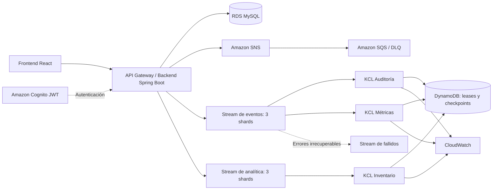

# Pedidos360

Sistema web B2B desarrollado para la gestión de pedidos entre locales y administración central.

## Arquitectura

El proyecto está compuesto por:

- **Frontend:** React + Vite.
- **Backend principal:** Spring Boot (Java 17).
- **Microservicio administrador:** Spring Boot.
- **Base de datos:** Amazon RDS MySQL.
- **Autenticación:** Amazon Cognito + JWT.
- **API:** Amazon API Gateway.
- **Mensajería asíncrona:** Amazon SNS + Amazon SQS.
- **Procesamiento de eventos:** Amazon Kinesis Data Streams + Kinesis Client Library (KCL).
- **Persistencia de progreso de consumo:** Amazon DynamoDB.
- **Monitoreo:** Amazon CloudWatch.
- **Infraestructura:** Amazon EC2.

## Estructura del repositorio

```text
Pedidos360_Backend_Gonzalez_Elgueta/
├── src/                  # Backend principal
├── admin-service/        # Microservicio administrador SNS/SQS
├── frontend/             # Aplicación React
├── pom.xml
└── README.md
```

> La estructura anterior corresponde a la documentación original del equipo. Antes de publicar, comprobar que las carpetas `admin-service/` y `frontend/` se encuentren efectivamente dentro de este repositorio; si son repositorios separados, sustituir esas rutas por sus enlaces.

## Evaluación Parcial 3 — Procesamiento de eventos con Kinesis y KCL

Se incorporó **Amazon Kinesis Data Streams** para publicar eventos de pedidos y analítica, y **Kinesis Client Library (KCL 3.5.3)** para procesarlos mediante aplicaciones consumidoras independientes. El backend utiliza **Spring Boot 4.1.1, Java 17 y Maven**; el despliegue de las pruebas se realizó en AWS Academy, región `us-east-1`.

### Streams configurados

| Stream | Función | Shards | Retención configurada |
|---|---|---:|---:|
| `pedidos360-eventos-stream` | Eventos operacionales de pedidos | 3 | 24 horas |
| `pedidos360-analitica-stream` | Eventos para analítica/inventario | 3 | 24 horas |
| `pedidos360-fallidos-stream` | Eventos con errores irrecuperables | 1 | 24 horas |

### Consumidores y checkpoints

| Aplicación consumidora KCL | Stream de origen | Tabla DynamoDB |
|---|---|---|
| `app-consumidora-auditoria` | `pedidos360-eventos-stream` | `app-consumidora-auditoria` |
| `app-consumidora-metricas` | `pedidos360-eventos-stream` | `app-consumidora-metricas` |
| `app-consumidora-inventario` | `pedidos360-analitica-stream` | `app-consumidora-inventario` |

Cada aplicación mantiene sus propios **leases y checkpoints** en DynamoDB. Se comprobó la creación de sus tablas y del índice `LeaseOwnerToLeaseKeyIndex` en estado `ACTIVE`.



> El diagrama es conceptual. Las rutas de gestión de errores se implementan en los consumidores/productores correspondientes; no significa que Kinesis reenvíe automáticamente los registros fallidos.

### Componentes Java utilizados

| Archivo | Responsabilidad |
|---|---|
| `AwsKinesisConfig.java` | Configuración de cliente Kinesis y streams. |
| `KinesisProducerService.java` | Publicación individual, por lotes y hacia stream de fallidos. |
| `KinesisPedidosConsumers.java` | Consumo de eventos por auditoría y métricas; checkpoints KCL. |
| `KinesisAnaliticaConsumer.java` | Consumo de eventos de analítica/inventario. |
| `StreamAdminService.java` | Administración de streams y consulta de seguimiento. |
| `EventoStreamDto.java` | Modelo de evento procesado. |

Las pruebas abarcaron eventos normales, errores transitorios con reintentos y derivación de errores irrecuperables al stream de fallidos. **KCL administra procesamiento al menos una vez**: los checkpoints permiten reanudar desde posiciones confirmadas, pero no equivalen por sí solos a una garantía de *exactly once*.

### Resultados reales demostrados

1. **Tres streams activos:** 3 shards de eventos, 3 de analítica y 1 de fallidos.
2. **Nueve leases verificados:** 3 shards asignados a cada aplicación consumidora.
3. **Checkpoints persistentes:** auditoría, métricas e inventario procesaron eventos de prueba y guardaron un `SequenceNumber` en DynamoDB, confirmado con `get-item`.
4. **Reinicio del backend:** los nuevos workers recuperaron los checkpoints anteriores y procesaron eventos nuevos.
5. **Distribución entre dos EC2:** en el grupo `app-consumidora-metricas`, los tres shards se repartieron entre dos workers (2 shards en la EC2 principal y 1 en la secundaria), verificado con `scan` de DynamoDB.
6. **Failover real:** al detener la EC2 secundaria, KCL reasignó los tres shards al worker principal.
7. **Continuidad posterior al fallo:** el evento sintético `EVT-FAILOVER-1795573195` se procesó en el shard recuperado `shardId-000000000002` y su checkpoint quedó guardado en DynamoDB.
8. **Métricas CloudWatch:** se observaron métricas KCL en los tres namespaces. Se crearon tres alarmas `pedidos360-kcl-fault-*` para `Fault` con dimensión `Operation=LeaseRenewerInitialize`.
9. **Versionamiento:** se publicó en la rama `main` el commit `53760bb`, que incorpora seis archivos de configuración y servicios KCL.

**Alcance de la evidencia:** las alarmas quedaron creadas (estado inicial `INSUFFICIENT_DATA`), pero no se comprobó su disparo real ni se configuraron notificaciones SNS. El segundo worker se implementó como proceso Java independiente **solo para demostrar balanceo y failover**; no es una segunda réplica funcional del backend REST o de los procesos SQS.

### Ejemplos de configuración

La aplicación principal utiliza variables de entorno para los datos sensibles de RDS y Cognito:

```properties
spring.datasource.url=${DB_URL}
spring.datasource.username=${DB_USER}
spring.datasource.password=${DB_PASSWORD}
spring.security.oauth2.resourceserver.jwt.issuer-uri=${COGNITO_ISSUER_URI}
cognito.client-id=${COGNITO_CLIENT_ID}
spring.cloud.aws.region.static=us-east-1

aws.kinesis.stream.pedidos=pedidos360-eventos-stream
aws.kinesis.stream.analitica=pedidos360-analitica-stream
aws.kinesis.stream.fallidos=pedidos360-fallidos-stream
aws.kinesis.shards.negocio=3
aws.kinesis.shards.fallidos=1
```

No subir archivos `.env`, claves privadas `.pem`, contraseñas, tokens o credenciales AWS al repositorio. Para EC2, las pruebas utilizaron un perfil de instancia IAM (`LabRole`).

### Compilación y despliegue

En la carpeta del backend, con Java 17:

```bash
./mvnw clean package -DskipTests
```

En Windows PowerShell:

```powershell
.\mvnw.cmd clean package "-DskipTests"
```

Para desplegar, cargar las variables de entorno del servidor y ejecutar el JAR construido. En la EC2 del laboratorio se utilizó la opción de Spring Cloud AWS `--spring.cloud.aws.credentials.instance-profile=true` para emplear el rol IAM asociado a la instancia.

> Los nombres de archivo JAR, rutas de despliegue, valores de Cognito y recursos de AWS Academy pueden variar en un entorno nuevo.
## Estado del proyecto

- **Comprobado:** procesamiento KCL, checkpoints persistentes, recuperación tras reinicio, reparto de shards entre dos EC2 y failover con evento posterior.
- **Creado, sin prueba de alarma:** alarmas CloudWatch para fallos de inicialización de lease renewer.

